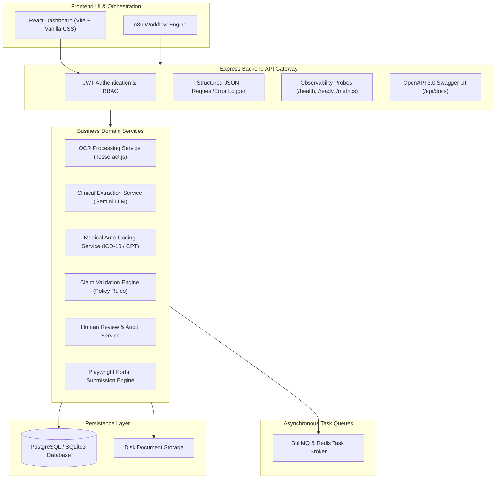

# ClaimPilot India 🚀

[](https://www.typescriptlang.org/)
[](https://react.dev/)
[](https://expressjs.com/)
[](https://www.docker.com/)
[](http://localhost:3001/api/docs)
[](https://redis.io/)
[](https://n8n.io/)
[](LICENSE)

> **AI-Assisted Hospital Insurance Claims Processing & Automated Portal Submission Platform for India's Healthcare Ecosystem.**

---

## 📌 Executive Summary

### Problem Statement
Indian hospitals process millions of health insurance claims (cashless pre-authorization, discharge summary approvals, and final reimbursements) across disparate Third-Party Administrator (TPA) and insurer portals (Star Health, HDFC ERGO, ICICI Lombard, Ayushman Bharat PM-JAY). Manual claim filing suffers from:
- High rejection rates due to missing clinical details or diagnostic errors.
- Slow manual coding for ICD-10-CM and CPT procedural codes.
- Labor-intensive web portal data entry resulting in high turnaround times (24-72 hours).
- Lack of auditability and status tracking for hospital billing operations.

### Solution
**ClaimPilot India** is an enterprise-grade, full-stack automation platform that streamlines hospital claim workflows from document ingestion to automated portal submission:
1. Ingests medical documents (PDF/PNG/JPEG) and extracts raw text via **Tesseract.js OCR**.
2. Structures unstructured medical records into validated clinical JSON using **Gemini LLM**.
3. Auto-codes clinical diagnoses and surgical procedures to **ICD-10-CM & CPT codes** with confidence scoring.
4. Evaluates compliance and tariff caps using a **Claim Validation Rules Engine**.
5. Routes complex/high-value claims to a **Human Reviewer Queue** with full auditability.
6. Automates web portal submissions using **Playwright Browser Automation Adapters**.
7. Sequences end-to-end workflows asynchronously via **n8n Webhooks & BullMQ Redis Queues**.

---

## 🏗️ System Architecture



---

## ⚡ Core Features

- 📄 **Multi-Format Document Upload & OCR**: Upload medical records (max 20MB) with background Tesseract.js text extraction.
- 🤖 **Gemini LLM Clinical Extraction**: Automated transformation of physician notes into validated structured JSON.
- 🩺 **ICD-10 & CPT Medical Auto-Coding**: High-confidence dictionary & fuzzy matching for diagnostic & procedure codes.
- ⚖️ **Claim Validation Engine**: Evaluates demographic completeness, claim amounts, supporting docs, and coding confidence thresholds.
- 👨‍⚕️ **Human Reviewer Workspace**: Interactive review queue for hospital medical officers (`REVIEWER` role) with persistent `review_history` audit trails.
- 🌐 **Playwright Portal Submission Adapters**: Flexible `IPortalAdapter` architecture generating official portal submission reference IDs.
- 🔄 **n8n Webhook Workflow Orchestration**: External webhook integration (`POST /api/webhooks/claim-event`) with stage retries.
- 📊 **Production Observability & Metrics**: Real-time telemetry (`/metrics`), health check (`/health`), readiness probe (`/ready`), and interactive Swagger UI (`/api/docs`).

---

## 💻 Technology Stack

| Layer | Technology |
| :--- | :--- |
| **Frontend UI** | React 18, Vite, TypeScript, Lucide Icons, Vanilla CSS Design System |
| **Backend API** | Node.js 20, Express, TypeScript, Zod Schema Validation |
| **Database** | SQLite3 (Development) / PostgreSQL (Production) |
| **Queues & Cache** | BullMQ, Redis 7 |
| **AI / LLM** | Google Gemini API (`@google/genai`), Tesseract.js OCR |
| **Browser Automation** | Playwright Adapter Pattern |
| **Orchestration** | n8n Workflow Webhooks |
| **Containers & CI** | Docker, Docker Compose, GitHub Actions |

---

## 📁 Repository Structure

```
Claim_bot_2/
├── backend/
│   ├── src/
│   │   ├── config/          # Environment, Redis, Postgres, & Swagger configs
│   │   ├── controllers/     # Express HTTP request handlers
│   │   ├── database/        # SQLite/Postgres schema & migration scripts
│   │   ├── jobs/            # BullMQ job types, queue service, & workers
│   │   ├── llm/             # Gemini LLM prompts & Zod validators
│   │   ├── middleware/      # Auth, RBAC, request/error logging, & metrics
│   │   ├── ocr/             # Tesseract.js OCR service & worker
│   │   ├── coding/          # ICD-10 & CPT auto-coding engines
│   │   ├── validation/      # Policy rules engine & rule definitions
│   │   ├── review/          # Human review service, repository, & audit log
│   │   ├── submission/      # Playwright portal adapters & submission service
│   │   ├── webhooks/        # n8n workflow trigger & stage retry endpoints
│   │   ├── repositories/    # Database persistence layers
│   │   ├── routes/          # Express API route declarations
│   │   ├── services/        # Core business domain services
│   │   └── app.ts           # Express application initialization
│   └── package.json
├── docs/
│   ├── architecture.md      # Detailed Mermaid architecture diagrams
│   ├── deployment.md        # Docker & production deployment guide
│   ├── screenshots.md       # Visual gallery & interface previews
│   ├── api-overview.md      # API reference summary
│   └── n8n/                 # n8n workflow export JSON & guide
├── .github/
│   ├── workflows/           # GitHub Actions CI/CD pipelines
│   └── ISSUE_TEMPLATE/      # Bug & feature templates
├── docker-compose.yml       # Production stack orchestrator
├── Dockerfile.backend       # Multi-stage backend container
├── Dockerfile.frontend      # Multi-stage React/Nginx container
├── README.md
├── LICENSE                  # MIT License
└── CHANGELOG.md             # Semantic version release log
```

---

## 🚀 Quick Start & Installation

### Option 1: Running via Docker Compose (Recommended)

1. Clone the repository:
   ```bash
   git clone https://github.com/your-username/Claim_bot_2.git
   cd Claim_bot_2
   ```

2. Copy environment template:
   ```bash
   cp .env.example .env
   ```

3. Launch the container stack:
   ```bash
   docker-compose up -d --build
   ```

4. Access services:
   - **Frontend App**: `http://localhost` (Port 80)
   - **Backend REST API**: `http://localhost:3001` (Port 3001)
   - **Swagger OpenAPI Docs**: `http://localhost:3001/api/docs`
   - **Health Endpoint**: `http://localhost:3001/health`
   - **n8n Workflow Engine**: `http://localhost:5678`

---

### Option 2: Running Locally for Development

1. Install Frontend & Root Dependencies:
   ```bash
   npm install
   ```

2. Install Backend Dependencies:
   ```bash
   cd backend
   npm install
   ```

3. Run Database Migrations:
   ```bash
   npm run migrate
   ```

4. Start Backend Server:
   ```bash
   npm run dev
   ```

5. In a separate terminal, start Frontend Dev Server:
   ```bash
   # In root directory
   npm run dev
   ```

---

## 📋 Environment Variables (`.env.example`)

```env
NODE_ENV=development
PORT=3001
CORS_ORIGIN=*

# JWT Authentication
JWT_SECRET=your_jwt_secret_key_here
JWT_EXPIRES_IN=1d

# Database Configuration (sqlite | postgres)
DB_DRIVER=sqlite
PG_HOST=localhost
PG_PORT=5432
PG_DATABASE=claimpilot
PG_USER=postgres
PG_PASSWORD=postgres

# Redis Queue Broker
REDIS_URL=redis://localhost:6379

# Google Gemini API Key
GEMINI_API_KEY=your_gemini_api_key_here
```

---

## 📖 API Documentation

Interactive Swagger UI documentation is available at `http://localhost:3001/api/docs`. For a summary of active endpoints and request contracts, consult [docs/api-overview.md](docs/api-overview.md).

---

## 🖼️ Media & Screenshots

Consult the visual gallery in [docs/screenshots.md](docs/screenshots.md) to inspect preview mockups of the Executive Dashboard, Human Reviewer Interface, Swagger UI, and n8n Workflows.

---

## 🔮 Future Roadmap

- 🔮 **WHO ICD-11 API Integration**: Dynamic vector-embedding lookup for rare clinical conditions.
- 🔮 **Direct AB-PMJAY Portal Connector**: Native Playwright browser automation script for Ayushman Bharat portals.
- 🔮 **Real-time WebSocket Push**: Instant UI dashboard notifications on claim status transitions.

---

## 🤝 Contributors

Developed with ❤️ by the **ClaimPilot India Engineering Team**.

---

## 📜 License

This project is licensed under the **MIT License** — see the [LICENSE](LICENSE) file for details.
