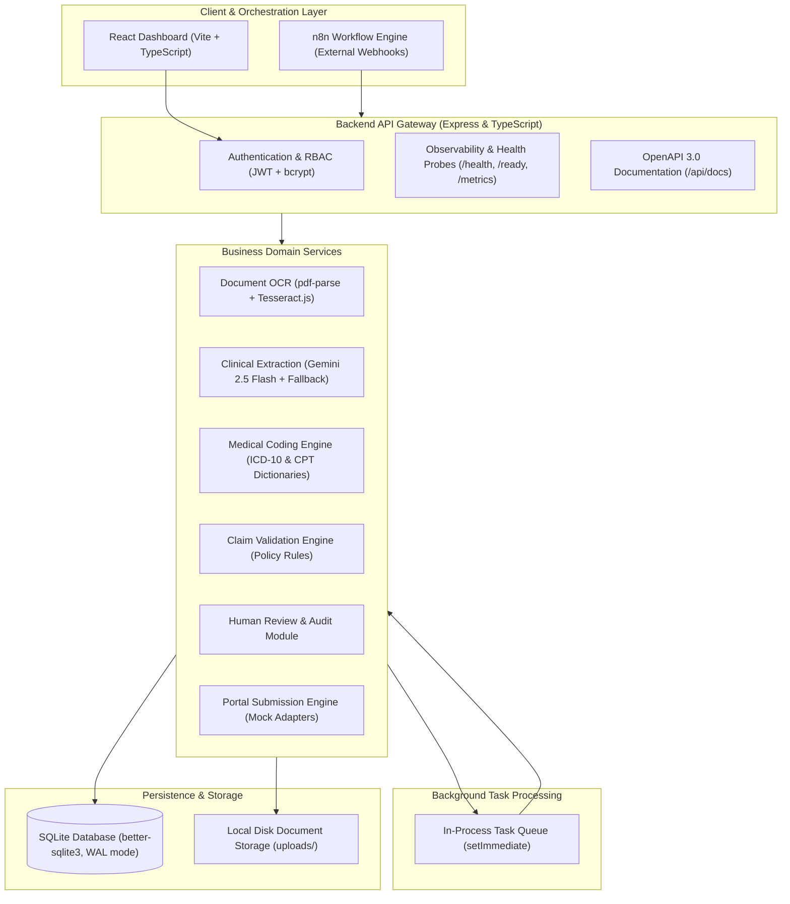

# ClaimPilot India

[](https://www.typescriptlang.org/)
[](https://react.dev/)
[](https://expressjs.com/)
[](https://www.sqlite.org/)
[](https://www.docker.com/)
[](http://localhost:3001/api/docs)
[](https://n8n.io/)
[](LICENSE)

> **Assisted Hospital Insurance Claims Processing & Automated Workflow Platform for Indian Healthcare Operations.**

---

## 1. Overview

### Problem Statement
Hospitals in India process high volumes of health insurance claims (cashless pre-authorization, discharge approvals, and final reimbursements) across disparate Third-Party Administrator (TPA) and insurer portals (Star Health, HDFC ERGO, ICICI Lombard, Ayushman Bharat PM-JAY). Manual claim filing faces recurring operational challenges:
- High rejection rates resulting from missing clinical fields or mismatched diagnostic codes.
- Labor-intensive manual coding for ICD-10-CM and CPT procedural codes.
- Repetitive portal data entry with turnaround times spanning 24 to 72 hours.
- Fragmented audit trails across hospital billing and TPA communications.

### Solution
**ClaimPilot India** provides a full-stack automation platform that coordinates the hospital claim lifecycle from document ingestion through structured extraction, validation, and simulated portal submission:
1. **Document Ingestion & OCR**: Accepts medical records (PDF/PNG/JPEG) and extracts text via `pdf-parse` and `tesseract.js`.
2. **Clinical Structuring**: Transforms unstructured medical text into validated clinical JSON using the Google Gemini API (`@google/genai`), with an offline regex heuristic fallback engine when unconfigured.
3. **Medical Auto-Coding**: Maps clinical diagnoses and procedures to ICD-10-CM and CPT codes using curated lookup dictionaries and regex matching with confidence scoring.
4. **Policy Rules Engine**: Evaluates demographic completeness, tariff boundaries, and code confidence against deterministic policy rules.
5. **Human Reviewer Queue**: Routes flagged or high-value claims to an interactive medical reviewer workspace with full audit trails.
6. **Portal Submission**: Dispatches approved claim payloads through portal submission adapters, returning tracked reference tokens.
7. **External Workflow Orchestration**: Sequences multi-stage pipeline runs asynchronously via n8n webhook triggers.

---

## 2. System Architecture



For full architectural specifications, component boundaries, and entity relationship diagrams, see [docs/ARCHITECTURE.md](docs/ARCHITECTURE.md).

---

## 3. Technology Stack

| Layer | Technology | Implementation Notes |
| :--- | :--- | :--- |
| **Frontend UI** | React 18, Vite, TypeScript, Lucide Icons, Vanilla CSS | Single-page application with React Router v6 navigation. |
| **Backend API** | Node.js 20, Express 4, TypeScript, Zod | Multi-layer architecture with standardized response envelopes. |
| **Database** | SQLite3 via `better-sqlite3` | WAL mode, foreign key enforcement, migration runner. |
| **Document Processing** | `pdf-parse`, `tesseract.js` | Direct stream extraction with OCR fallback for scans. |
| **Clinical Extraction** | Google Gemini API (`@google/genai`) | `gemini-2.5-flash` model with local regex fallback mode. |
| **Medical Coding** | TypeScript Rule Engine | Curated static dictionaries and regex matching with confidence scoring. |
| **Portal Integration** | TypeScript Adapter Pattern | `MockPortalAdapter` generating formatted execution receipts. |
| **Workflow Engine** | n8n | External webhook integration (`POST /api/webhooks/claim-event`). |
| **Containers** | Docker, Docker Compose | Multi-stage Dockerfiles for frontend and backend. |

---

## 4. Repository Structure

```
agentic-medclaims-automation/
├── backend/
│   ├── src/
│   │   ├── config/          # Environment, database, and Swagger configuration
│   │   ├── controllers/     # Express HTTP route controllers
│   │   ├── database/        # SQLite schema and migration runner
│   │   ├── llm/             # Gemini API client, prompts, and Zod validator
│   │   ├── ocr/             # Tesseract.js and pdf-parse extraction services
│   │   ├── coding/          # ICD-10 and CPT coding mappers
│   │   ├── validation/      # Claim policy rules engine
│   │   ├── review/          # Human review controller, repository, and audit log
│   │   ├── submission/      # Portal submission adapter implementations
│   │   ├── webhooks/        # n8n workflow webhook handlers
│   │   ├── middleware/      # Auth, RBAC, request logging, and telemetry metrics
│   │   ├── repositories/    # Typed database persistence repositories
│   │   ├── routes/          # Express route definitions
│   │   └── server.ts        # Backend server entry point
│   └── package.json
├── docs/
│   ├── ARCHITECTURE.md          # Comprehensive architecture and entity relations
│   ├── API_REFERENCE.md         # Active endpoint definitions and payload contracts
│   ├── CONFIGURATION_GUIDE.md   # Environment variables and setup instructions
│   ├── DATA_FLOW.md             # End-to-end data transformation pipeline
│   ├── KNOWN_LIMITATIONS.md     # Honest technical constraints and architecture boundaries
│   ├── PROJECT_GLOSSARY.md      # Indian health insurance domain terminology
│   ├── deployment.md            # Docker Compose deployment instructions
│   └── n8n/                     # Exported n8n workflow JSON and guide
├── src/                         # React frontend UI (pages, layouts, router)
├── docker-compose.yml           # Multi-container orchestration stack
├── Dockerfile.backend           # Multi-stage backend container
├── Dockerfile.frontend          # Multi-stage React/Nginx container
├── package.json                 # Frontend dependencies and scripts
├── LICENSE                      # MIT License
└── CHANGELOG.md                 # Semantic version release log
```

---

## 5. Quick Start & Local Execution

### Option 1: Running via Docker Compose

1. Clone the repository:
   ```bash
   git clone https://github.com/kik1211/agentic-medclaims-automation.git
   cd agentic-medclaims-automation
   ```

2. Configure environment:
   ```bash
   cp .env.example .env
   ```

3. Start services:
   ```bash
   docker-compose up -d --build
   ```

4. Verify access:
   - **Frontend UI**: `http://localhost` (Port 80)
   - **Backend REST API**: `http://localhost:3001`
   - **Interactive API Docs (Swagger)**: `http://localhost:3001/api/docs`
   - **Health Endpoint**: `http://localhost:3001/health`
   - **n8n Workflow Engine**: `http://localhost:5678`

---

### Option 2: Running Locally for Development

1. **Install Root & Frontend Dependencies**:
   ```bash
   npm install
   ```

2. **Install Backend Dependencies**:
   ```bash
   cd backend
   npm install
   ```

3. **Initialize Database**:
   ```bash
   npm run migrate
   ```

4. **Start Backend Server**:
   ```bash
   npm run dev
   # Backend listening at http://localhost:3001
   ```

5. **Start Frontend Dev Server** (in a separate terminal):
   ```bash
   # In root directory
   npm run dev
   # Vite UI dev server available at http://localhost:3000
   ```

For detailed environment variables and security notices, consult the [Configuration Guide](docs/CONFIGURATION_GUIDE.md).

---

## 6. Technical Documentation Index

- [Architecture & System Design](docs/ARCHITECTURE.md)
- [REST API Reference & Contracts](docs/API_REFERENCE.md)
- [Configuration & Security Guide](docs/CONFIGURATION_GUIDE.md)
- [Data Flow & Pipeline Transformations](docs/DATA_FLOW.md)
- [Known Limitations & Technical Constraints](docs/KNOWN_LIMITATIONS.md)
- [Domain Glossary & Insurance Terminology](docs/PROJECT_GLOSSARY.md)
- [Docker Production Deployment Guide](docs/deployment.md)
- [n8n Workflow Orchestration Guide](docs/n8n/workflow.md)

---

## 7. License

This project is licensed under the [MIT License](LICENSE).
