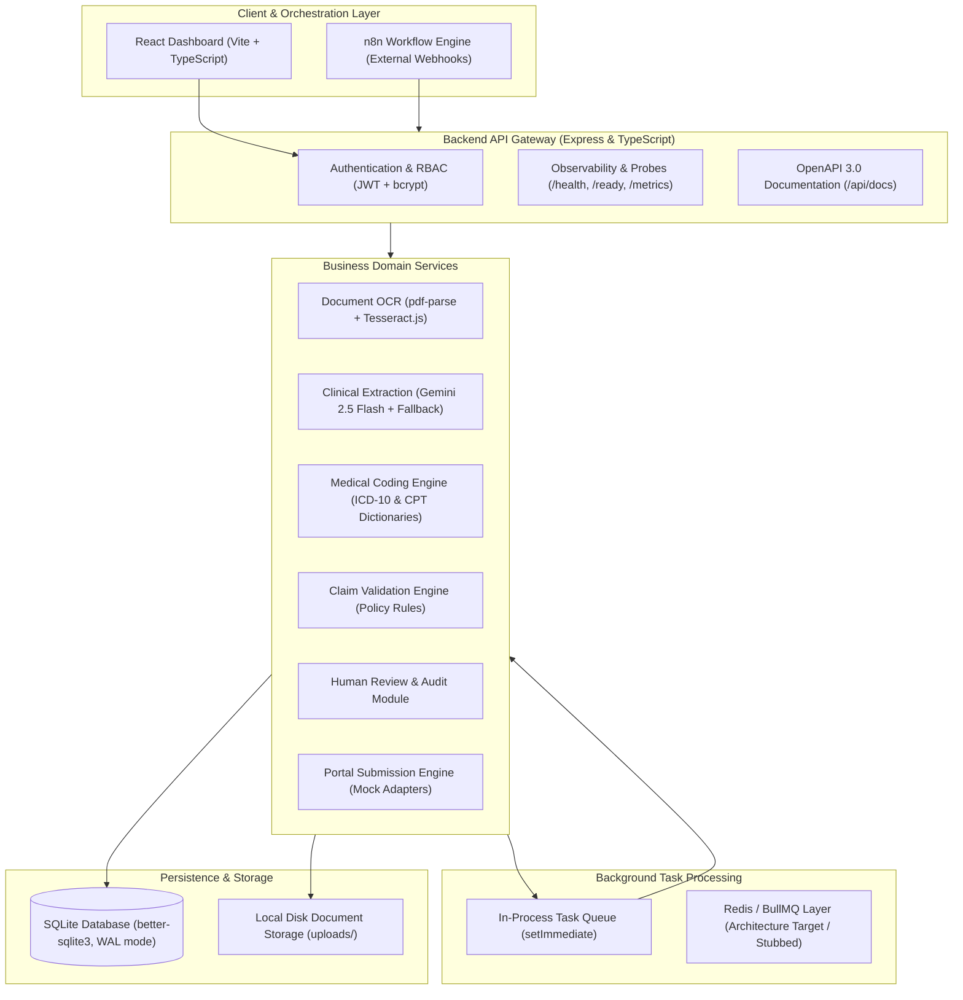
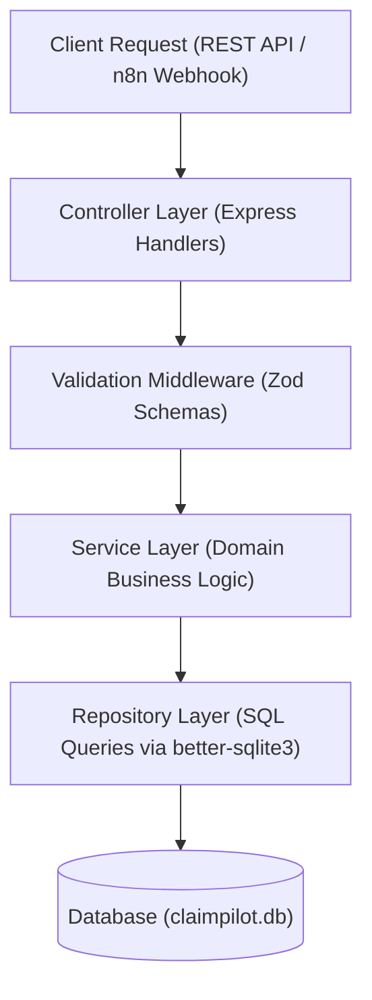
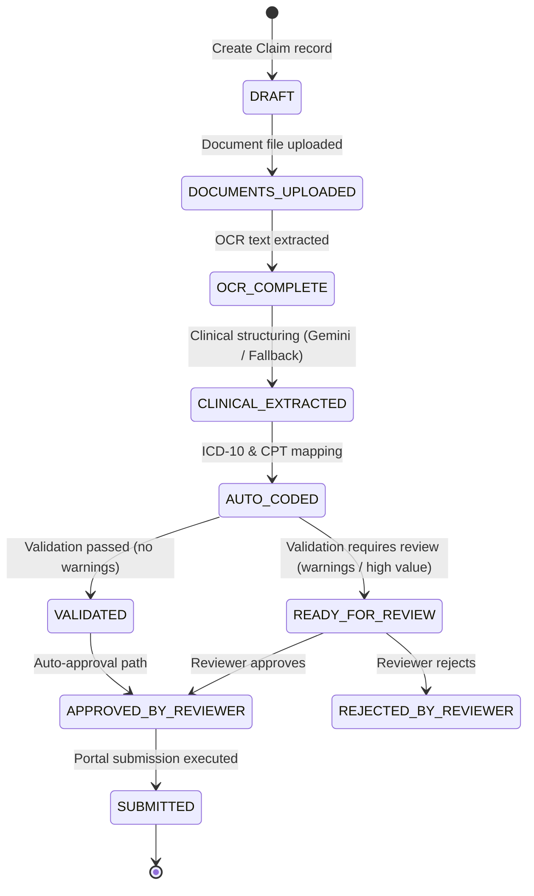
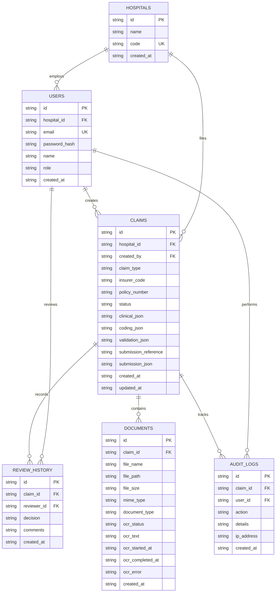
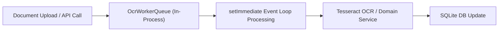

# ClaimPilot India — System Architecture & Design Specification

## 1. High-Level System Architecture

ClaimPilot India is designed as a modular, monolithic Express and TypeScript platform for hospital claims processing, integrating document OCR, LLM-based clinical structuring, rule-based medical coding, validation rules, human-in-the-loop review, and automated portal submission.

---

## 2. Multi-Layer Backend Design

The backend enforces strict separation of concerns across four discrete layers:

1. **Controller Layer** (`backend/src/controllers/`): Handles HTTP transport, parses incoming requests, delegates to service classes, and serializes responses via a standardized envelope (`SuccessResponse<T>` / `ErrorResponse`).
2. **Middleware & Validation** (`backend/src/middleware/`, `backend/src/schemas/`): Enforces JWT authentication, role-based authorization (`ADMIN`, `REVIEWER`, `OPERATOR`), request ID tracing, structured request/error logging, and strict Zod schema validation.
3. **Service Layer** (`backend/src/services/`, `backend/src/ocr/`, `backend/src/llm/`, `backend/src/coding/`, `backend/src/validation/`, `backend/src/review/`, `backend/src/submission/`): Implements all business rules, LLM prompting, OCR execution, rule evaluation, and workflow state transitions.
4. **Repository Layer** (`backend/src/repositories/`): Isolates SQL operations and database access behind typed interfaces using parameterized queries.

---

## 3. End-to-End Claim Lifecycle & State Machine

The processing pipeline coordinates claim transitions sequentially. Each stage reads from SQLite, executes its business logic, updates output columns, and advances the claim status.

### State Classification

| State | Implementation Status | Triggering Component | Description |
| :--- | :--- | :--- | :--- |
| `DRAFT` | **Implemented** | `ClaimController.create` | Initial claim record created. |
| `DOCUMENTS_UPLOADED` | **Implemented** | `DocumentController.upload` | At least one PDF/image attached. |
| `OCR_COMPLETE` | **Implemented** | `OcrService.processDocumentOcr` | Raw text extracted via pdf-parse or Tesseract.js. |
| `CLINICAL_EXTRACTED` | **Implemented** | `ClinicalService.structureClaimClinicalData` | Clinical JSON generated via Gemini (or regex fallback). |
| `AUTO_CODED` | **Implemented** | `CodingService.processClaimCoding` | Primary/secondary ICD-10 and CPT codes assigned. |
| `VALIDATED` | **Implemented** | `ValidationService.validateClaim` | Policy rules evaluated with zero approval triggers. |
| `READY_FOR_REVIEW` | **Implemented** | `ValidationService.validateClaim` | Claim flagged for human review (policy warnings or thresholds). |
| `APPROVED_BY_REVIEWER` | **Implemented** | `ReviewController.approveClaim` | Medical reviewer approved the claim payload. |
| `REJECTED_BY_REVIEWER` | **Implemented** | `ReviewController.rejectClaim` | Medical reviewer rejected the claim with recorded refusal notes. |
| `SUBMITTED` | **Implemented** | `SubmissionService.submitClaim` | Submission executed via portal adapter; reference ID generated. |
| `INSURER_APPROVED` | *Planned* | Insurer Callback / Scraper | Final claim settlement confirmed by insurer. |
| `INSURER_REJECTED` | *Planned* | Insurer Callback / Scraper | Claim rejected by insurer portal. |
| `DENIAL_ANALYSIS_IN_PROGRESS` | *Planned* | Denial Appeal Engine | Automated extraction and appeal generation for rejected claims. |

---

## 4. Processing Modules Overview

The pipeline comprises six core domain components:

### M1: Document Intelligence & OCR (`backend/src/ocr/`)
- Accepts PDF, PNG, and JPEG documents up to 20MB.
- Uses `pdf-parse` for fast text extraction from digital PDFs.
- Falls back to `tesseract.js` worker (`eng` language trained data) for scanned files or image payloads.
- Results are stored in the `documents` table (`ocr_text`, `ocr_status`, `ocr_completed_at`).

### M2: Clinical Data Structuring (`backend/src/llm/`)
- Concatenates OCR text across all completed claim documents.
- Prompts Google Gemini (`gemini-2.5-flash`) via the `@google/genai` SDK with strict JSON response constraints (`responseMimeType: "application/json"`).
- Extracts patient demographics, clinical summary, diagnosis strings, procedures, and claimed amounts.
- **Offline / Fallback Mechanism**: If `GEMINI_API_KEY` is not configured, a deterministic regex extraction engine executes locally, ensuring offline testability and resilience.
- Output is validated using Zod (`JsonValidator`) and persisted in `claims.clinical_json`.

### M3: Medical Auto-Coding Engine (`backend/src/coding/`)
- Maps clinical diagnosis strings to ICD-10-CM codes (`IcdService`).
- Maps procedure strings to CPT procedure codes (`CptService`).
- Implemented via curated medical dictionaries with regex matching and confidence scoring.
- Flags unlisted entries with fallback codes (`R69` for unspecified illness, `99214` for evaluation/management).
- Persisted in `claims.coding_json`.

### M4: Claim Validation Engine (`backend/src/validation/`)
- Evaluates extracted and coded data against deterministic hospital and insurer policy rules:
  - Patient demographic completeness (name, age, gender).
  - Diagnostic and procedural code presence.
  - Claim amount caps and reasonable hospital tariff ranges.
  - Minimum coding confidence thresholds (triggers review if confidence < 80%).
  - Required supporting document verification (discharge summary, lab reports).
- Determines whether the claim can proceed directly or must route to `READY_FOR_REVIEW`.
- Persisted in `claims.validation_json`.

### M5: Human Review & Audit Workspace (`backend/src/review/`)
- Dedicated review queue (`GET /api/review/pending`) restricted to users with the `REVIEWER` role.
- Allows human hospital billing and medical officers to inspect clinical JSON, suggested codes, validation warnings, and source documents.
- Records structured decisions (`APPROVED_BY_REVIEWER` or `REJECTED_BY_REVIEWER`) with reviewer ID, timestamp, and comments into `review_history` and `audit_logs`.

### M6: Portal Submission Engine (`backend/src/submission/`)
- Uses an adapter interface (`IPortalAdapter`) to route claims based on insurer code.
- Current implementation uses `MockPortalAdapter` to simulate portal interaction, generate timestamped execution logs, and assign a unique tracking reference (`REF_SUB_...`).
- Persisted in `claims.submission_reference` and `claims.submission_json`.

---

## 5. Database Schema & Entity Relationships

The operational database is SQLite (`claimpilot.db`) managed via `better-sqlite3` with foreign key enforcement and Write-Ahead Logging (`WAL`) enabled.

---

## 6. Asynchronous Task Processing & Queue Architecture

- **Current Implementation**: Asynchronous tasks (such as background OCR upon file upload) are managed through an in-process worker queue (`backend/src/workers/ocr.worker.ts`) using Node.js `setImmediate`.
- **Target Architecture**: Configuration stubs exist for Redis (`backend/src/config/redis.ts`) and BullMQ queue definitions (`backend/src/jobs/`). In the current development deployment, Redis runs in fallback mode and background jobs execute within the Node.js process.
