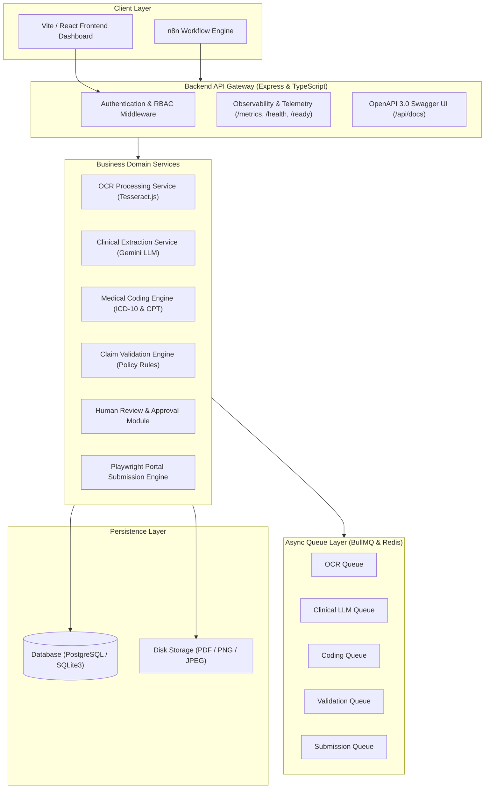
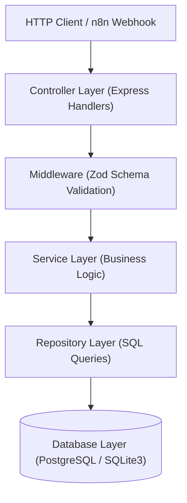
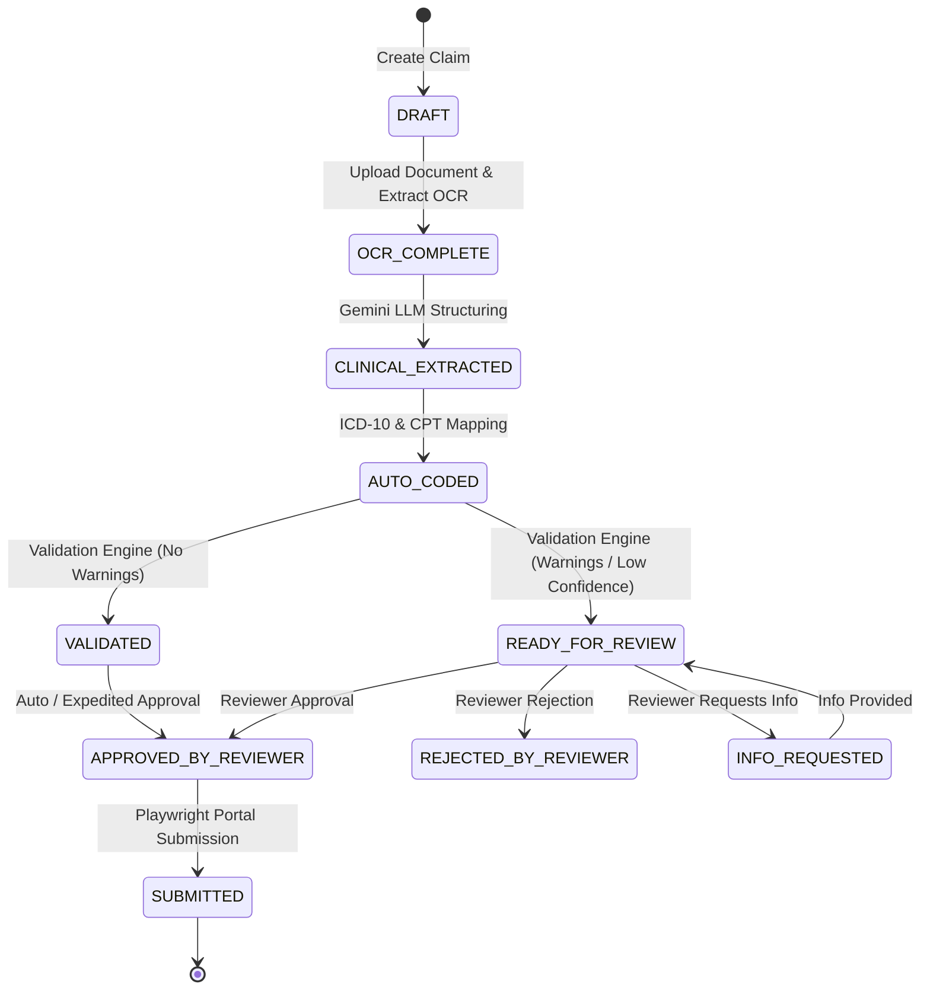
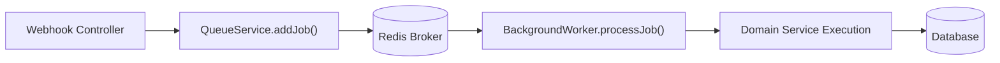
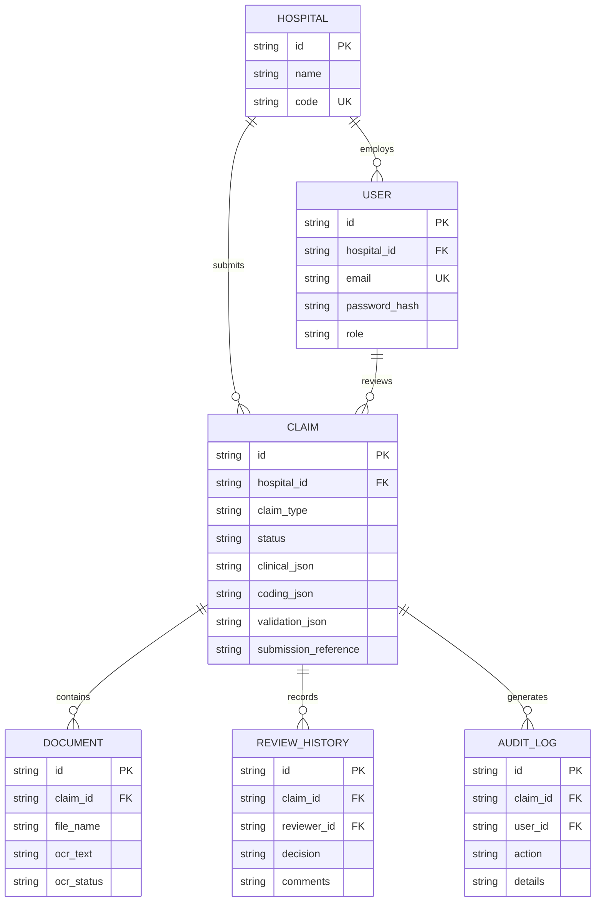

# ClaimPilot India — System Architecture & Design Specification

## 1. High-Level System Architecture

---

## 2. Multi-Layer Backend Architecture

---

## 3. End-to-End Claim Lifecycle Workflow

---

## 4. Queue Architecture (BullMQ & Redis)

---

## 5. Database Entity Relationship Diagram (ERD)

