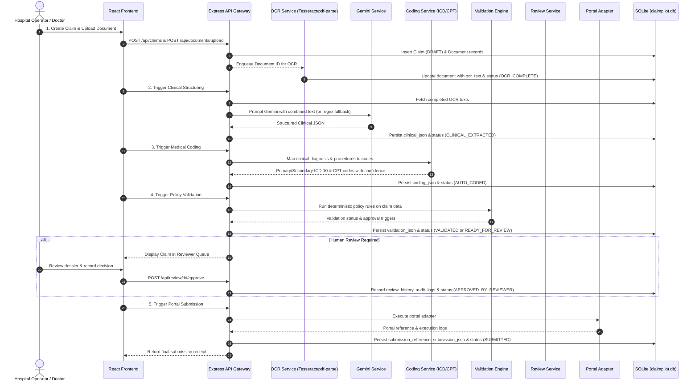

# ClaimPilot India — Data Flow Specification

This document details the end-to-end flow of data through the ClaimPilot platform, tracing inputs from initial document upload through OCR extraction, clinical structuring, medical coding, policy validation, human review, and portal submission.

---

## 1. High-Level Data Flow Sequence



---

## 2. Stage-by-Stage Data Transformation

### Stage 1: Document Ingestion & Storage
- **Input**: Multipart file upload (`PDF`, `PNG`, `JPEG`, max 20MB) accompanied by `claim_id` and `document_type`.
- **Processing**:
  - `DocumentController` saves the file to the local disk directory (`uploads/`).
  - Creates a row in the `documents` table with `ocr_status = 'PENDING'`.
  - Dispatches the `documentId` to `OcrWorkerQueue`.
- **Output Record (`documents`)**:
  ```json
  {
    "id": "doc_a1b2c3d4",
    "claim_id": "clm_98765432",
    "file_name": "discharge_summary.pdf",
    "file_path": "uploads/discharge_summary_1722360000.pdf",
    "mime_type": "application/pdf",
    "ocr_status": "PENDING"
  }
  ```

### Stage 2: OCR Text Extraction
- **Input**: Local file path on disk.
- **Processing**:
  - `TesseractService` inspects MIME type:
    - If `application/pdf`, direct text streams are extracted via `pdf-parse`.
    - If direct extraction produces empty text or for image payloads, `tesseract.js` worker processes the image with language model `eng`.
- **Output Record (`documents`)**:
  - `ocr_text`: Raw extracted plaintext.
  - `ocr_status`: `'COMPLETED'` or `'FAILED'`.
  - Updates associated claim status to `'OCR_COMPLETE'`.

### Stage 3: Clinical Data Structuring
- **Input**: Concatenated OCR text across all completed documents for the claim.
- **Processing**:
  - `ClinicalService` aggregates texts and formats the prompt via `PromptBuilder`.
  - `GeminiService` invokes `@google/genai` (`gemini-2.5-flash`) requesting structured JSON.
  - *Fallback*: If `GEMINI_API_KEY` is not set, a local regex heuristic parser extracts fields.
  - `JsonValidator` verifies fields via Zod against `ClinicalDocumentDataSchema`.
- **Output Data Structure (`claims.clinical_json`)**:
  ```json
  {
    "patient_name": "Rajesh Kumar",
    "patient_age": 45,
    "gender": "MALE",
    "hospital_name": "Sri Ramakrishna Hospital",
    "doctor_name": "Dr. K. Swaminathan",
    "admission_date": "2026-07-28",
    "discharge_date": "2026-07-30",
    "diagnosis": "Acute Appendicitis K35.80",
    "procedures": ["Laparoscopic Appendectomy"],
    "medications": ["IV Ceftriaxone 1g", "Paracetamol 500mg"],
    "claim_amount": 65000,
    "supporting_documents": ["Pre-Auth Form", "Lab Report", "Discharge Summary"],
    "clinical_summary": "Patient presented with right lower quadrant abdominal pain..."
  }
  ```
  - Claim status advances to `'CLINICAL_EXTRACTED'`.

### Stage 4: Medical Auto-Coding
- **Input**: `claims.clinical_json` (`diagnosis` string and `procedures` array).
- **Processing**:
  - `IcdService.mapDiagnosis`: Scans diagnosis string against ICD-10 dictionary terms and regex patterns (e.g. `K35.80`).
  - `CptService.mapProcedures`: Scans procedures against CPT procedural dictionary (e.g. `44970`).
- **Output Data Structure (`claims.coding_json`)**:
  ```json
  {
    "primary_icd10": {
      "code": "K35.80",
      "description": "Unspecified acute appendicitis",
      "confidence": 95
    },
    "secondary_icd10": [],
    "cpt_codes": [
      {
        "code": "44970",
        "description": "Laparoscopy, surgical, appendectomy",
        "category": "Surgery / Digestive",
        "confidence": 90
      }
    ],
    "confidence_scores": {
      "K35.80": 95,
      "44970": 90
    },
    "coding_status": "COMPLETED"
  }
  ```
  - Claim status advances to `'AUTO_CODED'`.

### Stage 5: Policy Validation & Human Review Routing
- **Input**: Combined `clinical_json` and `coding_json`.
- **Processing**:
  - `ValidationRulesEngine` applies rules:
    - Required demographic verification.
    - Diagnosis and procedure code presence.
    - Code confidence threshold checking (confidence >= 80%).
    - Hospital tariff boundary checks (amount <= ₹500,000 for standard pre-auth).
    - Supporting document completeness.
- **Output Data Structure (`claims.validation_json`)**:
  ```json
  {
    "validation_status": "PASSED",
    "approval_required": false,
    "warnings": [],
    "rule_results": [
      { "ruleId": "DEMOGRAPHICS_CHECK", "passed": true },
      { "ruleId": "DIAGNOSIS_CODED", "passed": true },
      { "ruleId": "CONFIDENCE_THRESHOLD", "passed": true }
    ]
  }
  ```
  - If `approval_required == false`, claim status advances to `'VALIDATED'`.
  - If `approval_required == true` or warnings exist, claim status transitions to `'READY_FOR_REVIEW'`.

### Stage 6: Human Review Decision
- **Input**: Human reviewer action via `POST /api/review/:claimId/approve` or `reject`.
- **Processing**:
  - Validates reviewer role (`REVIEWER`).
  - Inserts entry into `review_history` (reviewer ID, decision, timestamp, comments).
  - Inserts record into `audit_logs`.
  - Claim status transitions to `'APPROVED_BY_REVIEWER'` or `'REJECTED_BY_REVIEWER'`.

### Stage 7: Portal Submission
- **Input**: Approved claim payload (`clinical_json`, `coding_json`, `insurer_code`).
- **Processing**:
  - `PlaywrightService` passes claim to `MockPortalAdapter`.
  - Generates synthetic portal submission reference and logs.
- **Output Data Structure (`claims.submission_json` & `claims.submission_reference`)**:
  ```json
  {
    "portal_reference": "REF_SUB_LZ04B_CLM123",
    "submission_status": "SUBMITTED",
    "submitted_at": "2026-07-30T19:15:00.000Z",
    "portal_name": "STAR_HEALTH_MOCK_PORTAL",
    "submission_logs": [
      "[2026-07-30T19:15:00.000Z] Submission started",
      "[2026-07-30T19:15:00.100Z] Filling patient details: Rajesh Kumar",
      "[2026-07-30T19:15:00.200Z] Populating ICD-10 (K35.80) and 1 CPT codes",
      "[2026-07-30T19:15:00.300Z] Portal reference generated: REF_SUB_LZ04B_CLM123"
    ]
  }
  ```
  - Claim status advances to `'SUBMITTED'`.
